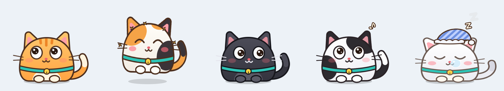
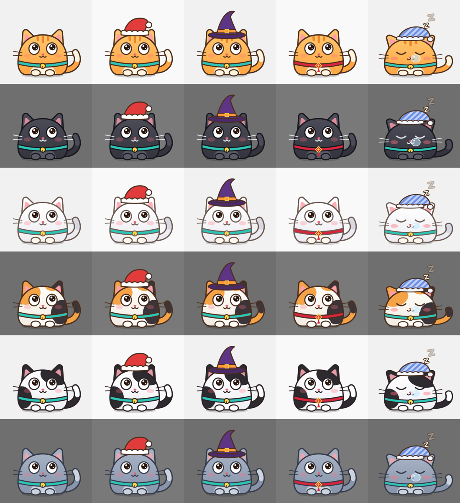
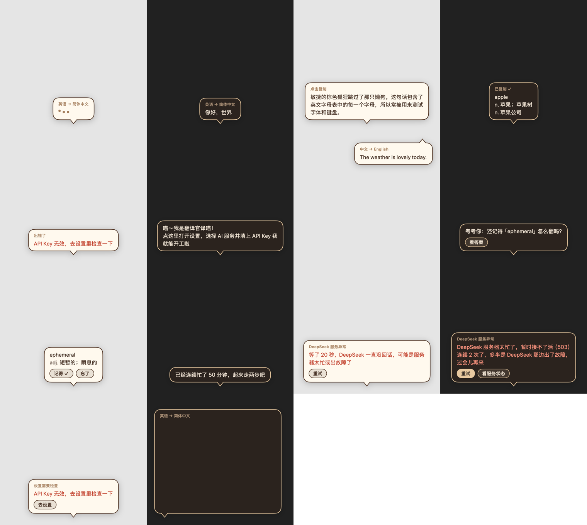

# 译喵 Yimiao

住在 macOS 桌面上的翻译猫。在任何 App 里选中文字，他就跳到旁边，调用 DeepSeek 或 Kimi 翻译，把译文用气泡递到你眼前。平时他就是只猫：眼睛跟着鼠标转，扑你晃的鼠标，跟着你打字的节奏摇尾巴，听到歌摇头晃脑，偶尔跳到窗口顶上坐一会儿。他还会记下你查过的词过几天来考你，在你坐太久、该下班、该睡觉的时候提醒一声。

*A cat that lives on your Mac desktop and translates whatever text you select, using DeepSeek or Kimi. Native Swift with no dependencies. The app and its documentation are in Chinese.*



- 原生 Swift（AppKit + Core Animation），没有第三方依赖，常驻约 20 MB 内存，空闲时占一个核的 2–5%
- 需要 macOS 14 及以上，以及你自己的 DeepSeek 或 Kimi API Key
- 以 [MIT 许可证](LICENSE) 开源

## 构建和运行

目前没有预编译版本，需要自己构建：装好 Xcode 或 Command Line Tools，然后

```bash
git clone https://github.com/Hannah-bbbb/AI-Translation-Desk-Pet.git
cd AI-Translation-Desk-Pet
Scripts/build.sh --run
```

产物是 `build/译喵.app`，可以拖进「应用程序」。只有改了代码才需要重新构建，平时直接打开这个 App 就行。他没有 Dock 图标，入口是桌面上的猫和菜单栏里的猫头图标。

## 第一次使用

1. **选择 AI 服务并填 API Key**：右键点猫 → 设置 → 翻译，在「AI 服务」选择 DeepSeek 或 Kimi，填入对应平台的 Key，点「测试连接」。[创建 DeepSeek Key](https://platform.deepseek.com/api_keys) · [创建 Kimi Key](https://platform.kimi.com/console/api-keys)。各服务的 Key 分开保存在系统钥匙串里。
2. **给辅助功能权限**：设置 → 取词 → 去授权，在系统设置里打开「译喵」的开关。没有这个权限他看不到你选中的文字；缺权限时你一选中文字，他会冒气泡提醒，点气泡就能跳过去。

之后在任意 App 里拖选、双击或用 ⇧ 加方向键选中文字即可。

## 切换 DeepSeek / Kimi

在「设置 → 翻译 → AI 服务配置」切换服务即可，配置自动保存。两套 API Key、Base URL、模型与深度思考开关彼此独立，来回切换不用重填；升级前的 DeepSeek 配置会继续保留。切换后，后续翻译、连接测试和 AI 陪伴台词使用所选服务，已经发出的请求仍使用发出时的配置。

| 服务 | 默认 Base URL | 默认模型 | 模型预设 |
| --- | --- | --- | --- |
| DeepSeek | `https://api.deepseek.com` | `deepseek-flash` | `deepseek-flash`、`deepseek-v4-pro` |
| Kimi | `https://api.moonshot.cn/v1` | `kimi-k2.6` | `kimi-k2.6`、`kimi-k3` |

Kimi 默认关闭思考，适合快速翻译。K2.6 可开关思考；K3 始终思考，开关对应低/高推理强度。自填其他 Kimi 模型时使用该模型的服务默认参数。Base URL 和模型都可手动编辑；使用 Moonshot 国际站密钥时，可将地址改为 `https://api.moonshot.ai/v1`。只填接口根地址，不要加 `/chat/completions`。

Kimi 模型与参数依据[官方模型列表](https://platform.kimi.com/docs/models)和[模型参数参考](https://platform.kimi.com/docs/api/models-overview)配置。密钥应在对应 API 开放平台创建。从终端启动且尚未保存 Key 时，DeepSeek 读取 `DEEPSEEK_API_KEY`，Kimi 读取 `MOONSHOT_API_KEY`。

## 怎么玩

| 操作 | 效果 |
| --- | --- |
| 选中文字 | 他跳到选区旁边翻译，气泡避开原文，说完回原位 |
| 点气泡 | 复制译文；有按钮时点按钮（看答案、重试、去设置…） |
| 鼠标停在气泡上 | 气泡不消失 |
| 单击猫 | 戳一下，同时收起气泡；睡着时是叫醒 |
| 双击猫 | 哄睡。睡着后不取词、不翻译、不发任何请求 |
| 拖动猫 | 拎到别处，位置会记住 |
| 在他身上来回摸 | 冒爱心 |
| 播放视频时 | 他自动滑到最近的屏幕边缘，只露半张脸，停播几秒后回来；点他或拖他可以叫出来 |
| 在他面前来回晃鼠标 | 他压低身子盯着、扭两下屁股，然后扑过去；扑中了很得意，扑空了东张西望 |
| 右键猫 / 菜单栏图标 | 睡觉、翻译剪贴板、今日小结、生词本、去窗口上坐坐、设置、退出 |

默认外语译成简体中文，中文译成英文，两个方向都能在设置里改。五分钟没有键鼠操作他会自己睡着，你回来时自己醒。

## 像只猫

这些都在「设置 → 桌宠」里，每项可以单独关：



- **毛色和装扮**：橘猫、黑猫、白猫、三花、奶牛猫、蓝猫。装扮默认按节日自动换：10 月 24 日到 11 月 1 日戴巫师帽，12 月 18 日到 26 日戴圣诞帽，农历腊月二十三到正月十五换红项圈和中国结；也可以固定一种或不戴。他睡着时会戴上睡帽。
- **陪我玩**：鼠标在他面前快速左右来回晃几下才会触发，按住鼠标拖选时不算，所以正常工作时不会被误触。扑完他会在那儿多待几秒，你可以接着逗；不玩了他自己回去。
- **陪你打字**：你打字时他的尾巴跟着拍、头一点一点；连续飞快地打一阵他会两眼放光；打了一段停下来想事情，他偶尔歪头看你。他只知道「有键按下」，不知道按的是哪个键，密码框里的输入系统也不会告诉他。
- **听到声音跟着晃**：有声音在放（系统音频输出在工作）且不是视频时，他摇头晃脑、冒音符，停了几秒后恢复。有些 App 会一直占着音频设备，如果他没在放歌时也晃，把这项关掉就好。
- **电量反应**：没插电且电量低于 20% 时他眼皮耷拉、耳朵下垂、少蹦跶；低于 10% 会提醒你充电（每次放电一次）；插上电时冒闪电、蹦一下。台式机没有电池，这项不起作用。
- **偶尔跳到窗口顶上坐着**：启动几分钟后第一次，之后每隔 15 到 35 分钟，挑你正在用的窗口坐到它顶边上，3 到 7 分钟后回原位。窗口拖动时他跟着走；窗口关掉、最小化、被别的窗口挡住他就回去。窗口占满屏幕时上面没地方坐，他会挑别的露在外面的窗口，都没有就算了。右键菜单「去窗口上坐坐 / 从窗口上下来」可以手动叫他。

## 什么时候翻译

「设置 → 翻译 → 取词 → 什么时候翻译」有两种：

- **选中就翻译**（默认）：任何拖选、双击、⇧ 加方向键选中都会翻译。
- **按住 ⌥ 选中才翻译**：按住 ⌥ 拖选、双击，或按住 ⌥ 用 ⇧ 方向键扩选时才翻译。有的 App 里 ⌥ 拖选是列选择，那就先正常选好，再单独轻按一下 ⌥，同样会翻译刚才选中的文字。⌥ 和别的键一起按（快捷键）不算。

气泡会按完整选区边界选择上下方或侧边空位，并为译文逐字增长预留空间；空间较小时使用紧凑气泡，长译文可以滚动。若当前屏幕没有空位，会尝试其他显示器；所有屏幕都放不下时，菜单栏出现「译文」，点击菜单里的「查看译文」查看或复制，不自动覆盖原文。读取不到选区边界时，鼠标拖选按经过的整段行区域避让；键盘或 Shift 扩选按焦点文本控件范围保守避让，因此气泡可能离原文更远。

## 他什么时候会主动开口

每句话都有由头，不靠定时器随机冒出来：

| 由头 | 默认 |
| --- | --- |
| 每天第一次见面 | 打招呼 |
| 离开半小时以上回来 | 欢迎回来 |
| 连续用了 50 分钟没歇过 | 劝你起来走走；不理他的话隔 30 分钟、1 小时、2 小时再提 |
| 听劝休息完回来 | 打个气 |
| 到了下班时间（18:30）你还在 | 劝收工，每天一次 |
| 过了睡觉时间（23:30）你还在 | 催睡，每 45 分钟一次 |
| 当天翻译到第 20、50、100 段 | 邀个功 |
| 生词到期 | 考你一个 |
| 没插电且电量低于 10% | 提醒充电，每次放电一次 |

停手 5 分钟算一次休息。两次开口至少隔 10 分钟。他睡着时、正在翻译时、躲在屏幕边缘看你看视频时、你在全屏演示时不出声，所以双击哄睡就是免打扰。

下班提醒会附上**今日小结**：翻译了几段、查了几个新词、休息了几次（离开 5 分钟以上算一次）。不想要可以在「设置 → 陪伴」里关；右键菜单的「今日小结」随时能看。

台词默认由模型按当时的情况现写一句（一次很小的请求），没有 Key、请求失败或在设置里关掉时用内置台词。时间、间隔和每一类的开关都在「设置 → 陪伴」里。

## 生词本

选中单词或短语（三个词以内）翻译后会自动收录，在右键菜单的「生词本」里查看和删除。之后隔 1、3、7、16、35 天各考一次：他报出词，你想一想，点「看答案」，再告诉他记得还是忘了。忘了就从 1 天重新来，再查一次同一个词也是。数据存在 `~/Library/Application Support/Yimiao/vocabulary.json`。



## 取词是怎么做的

优先用辅助功能接口直接读选区。Chrome、VS Code、微信这类读不到选区的 App 走「兼容模式」：替你按一下 ⌘C，读完立刻把剪贴板还原。兼容模式只在鼠标拖选或双击后触发，可以在设置里关掉。

醒着时，选中的文字会发送给你配置的接口（默认 DeepSeek）。不想被翻译的时候让他睡觉。

## 其他

- **模型**：默认服务仍为 DeepSeek，可按上面的说明切换 Kimi。设置里可选择预设或手动输入模型名。Base URL 可以指向兼容 OpenAI Chat Completions 接口的服务；本机和局域网地址允许用 http。
- **服务出问题时**：DeepSeek 繁忙时不会拒绝请求，而是挂着连接发心跳，最长十分钟。所以他自己计时：20 秒没收到任何回答就报「一直没回话」，回答到一半停住 20 秒报「没动静了」，服务端中途掐断（`insufficient_system_resource` 等）也会说明。气泡标题会写明是「DeepSeek 服务异常」「网络问题」还是「设置需要检查」，并给出「重试」或「去设置」按钮；连续失败时再加「看服务状态」，打开 status.deepseek.com。设置里的「测试连接」同样最多等 20 秒，等待时显示秒数，可以随时取消。
- **他怎么知道在放视频**：播放器、浏览器和视频会议在画面播放时都会向系统申请「别让显示器休眠」，暂停就撤回，他看的是这个信号。后台放音乐不算；caffeinate、Amphetamine 这类防休眠工具被排除在外。躲着的时候选中文字，他照样会跳过来翻译，说完回到边缘。不想要可以在「设置 → 桌宠」里关。
- **从别的工具喂文字**：`open "yimiao://translate?text=Hello"`，可以接快捷指令、Raycast、脚本。加上 `&x=800&y=560`（从屏幕左下角算起的坐标）他会跳到那个位置去说。`open -g "yimiao://sit"` 让他去窗口上坐坐。
- **权限和重新构建**：macOS 按签名认 App。构建脚本给临时签名指定了「按应用标识符识别」的要求，所以重新构建不会丢掉辅助功能授权和钥匙串访问。代价是授权跟着标识符 `io.github.hannah-bbbb.yimiao` 走，而不是绑定某一个二进制；想绑定到证书，就在钥匙串里放一个代码签名证书，或用 `CODESIGN_IDENTITY` 指定，脚本会改用它签名。
- **开关明明开着却不取词**：多半是系统里留着一条旧版本的授权。点猫的提醒气泡（或设置里的「去授权…」），他会先清掉自己那条旧记录，再请你重新打开开关。
- **他没反应时看日志**（只记录来源 App 和字数，不记录文字内容）：

  ```bash
  /usr/bin/log stream --predicate 'subsystem == "io.github.hannah-bbbb.yimiao"'
  ```

## 代码结构

```
Sources/Yimiao/
  App/        PetController 把所有部件串起来；OverlayPanel 是透明悬浮窗
  Pet/        PetBrain 决定姿势（状态、弹簧、随机动作、扑鼠标、打字、跳舞、电量）
              PetRenderer 画各个部件，PetStage 把部件做成图层交给 GPU 合成
              Look 是毛色、装扮和节日日期
  Bubble/     气泡的状态和 SwiftUI 视图
  Translate/  SelectionWatcher 取词，LanguageRouter 判断方向，Translator 流式请求
  Companion/  Companion 决定什么时候开口，Lines 是台词，Vocabulary 是生词本
  Settings/   偏好、钥匙串、设置窗口
  Support/    日志；Snapshot 离屏渲染；Playback 判断视频；Surroundings 读声音、电量和别的窗口；
              AppIdentity 是应用标识符，Migration 从旧标识符导入设置
```

改了造型或气泡后不用启动 App 就能看效果：

```bash
swift run Yimiao --snapshot poses.png
swift run Yimiao --looks looks.png
swift run Yimiao --hero hero.png
swift run Yimiao --bubbles bubbles.png
swift run Yimiao --selection-layouts .build/selection-layouts.png
```

## 隐私

- **发出去的**：他醒着时，你选中的文字会发送给你在设置里配置的 AI 服务（默认 DeepSeek），从剪贴板或链接交给他翻译的文字也一样。陪伴台词由模型现编时，只发送场合描述，例如时间和今天翻译了几段，不包含你的任何文字。睡着时他不取词、不发任何请求。
- **存在本机的**：API Key 在系统钥匙串里，设置在系统偏好设置文件里，生词本在 `~/Library/Application Support/Yimiao/vocabulary.json`。
- **不碰的**：没有统计、遥测或任何上传。日志只写进本机系统日志，记录来源 App 和字数，不记录文字内容。陪你打字只知道「有键按下」，不知道按了哪个键。坐窗口时只读其他窗口的位置和所属 App，不读标题和内容。兼容模式会临时借用剪贴板，读完立刻还原。

## 参与贡献

开发环境、调试方法、提交规范和 fork 后改名的步骤见 [CONTRIBUTING.md](CONTRIBUTING.md)，变更历史见 [CHANGELOG.md](CHANGELOG.md)。

## 许可证

[MIT](LICENSE) © 2026 Hannah-bbbb
